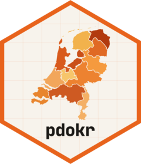

<!-- README.md is generated from README.Rmd. Please edit that file -->

```{r, include = FALSE}
knitr::opts_chunk$set(
  collapse = TRUE,
  comment = "#>",
  fig.path = "man/figures/README-",
  out.width = "100%"
)
```

# pdokr 

<!-- badges: start -->
[](https://lifecycle.r-lib.org/articles/stages.html#stable)
[](https://CRAN.R-project.org/package=pdokr)
[](https://github.com/coeneisma/pdokr/actions/workflows/R-CMD-check.yaml)
<!-- badges: end -->

`pdokr` makes it easy to work with open geographic data from
[PDOK](https://www.pdok.nl/) (Publieke Dienstverlening Op de Kaart), the
national geodata platform of the Netherlands. It helps you discover datasets and
their layers, load a layer as an [`sf`](https://r-spatial.github.io/sf/) object
(with automatic pagination and explicit coordinate reference system handling),
filter data by any polygon area or by attribute values on the server, and
geocode addresses and place names.

`pdokr` is a client for PDOK's **OGC API Features** services: it reads *vector*
feature data (points, lines, polygons) as `sf`. Raster, tile, and coverage
services are out of scope. For the official PDOK map background, use
`pdok_basemap()`.

## Installation

Install the released version of `pdokr` from
[CRAN](https://CRAN.R-project.org/package=pdokr):

``` r
install.packages("pdokr")
```

Or the development version from [GitHub](https://github.com/coeneisma/pdokr):

``` r
# install.packages("remotes")
remotes::install_github("coeneisma/pdokr@develop")
```

## Example

Pick an area from the administrative boundaries, then load another layer within
it, filtered on the server by an attribute. Here we take the historic center of
Delft and map every building from before 1800.

```{r example, message = FALSE}
library(pdokr)
library(tmap)

# A municipality, and one of its districts (the historic center of Delft)
gemeenten <- pdok_read(
  "cbs/gebiedsindelingen", "gemeente_gegeneraliseerd", datetime = 2025
)
delft <- gemeenten[gemeenten$statnaam == "Delft", ]

wijken <- pdok_read(
  "cbs/gebiedsindelingen", "wijk_gegeneraliseerd", datetime = 2025,
  filter_by = delft, predicate = "within"
)
binnenstad <- wijken[wijken$statnaam == "Wijk 11 Binnenstad", ]

# Every building in that district built before 1800, from the BAG.
# The construction-year filter runs on the PDOK server.
buildings <- pdok_read(
  "kadaster/bag", "pand",
  filter_by = binnenstad,
  filter = pdok_where(bouwjaar < 1800)
)

# Map it
tmap_mode("plot")
tm_basemap(pdok_basemap("grijs")) +
  tm_shape(binnenstad) +
  tm_borders(col = "grey40") +
  tm_shape(buildings) +
  tm_polygons(fill = "#d95f02", col = "white", lwd = 0.4) +
  tm_title("Buildings from before 1800 in the historic center of Delft") +
  tm_credits("Kaartgegevens © Kadaster")
```

The articles on the [package website](https://coeneisma.github.io/pdokr/) walk
through this and other workflows, with interactive, zoomable maps.

## Learn more

See the [package website](https://coeneisma.github.io/pdokr/) for the reference
documentation and articles on getting started, filtering data by area or by
attribute, working with coordinate reference systems, and querying PDOK by
hand.
